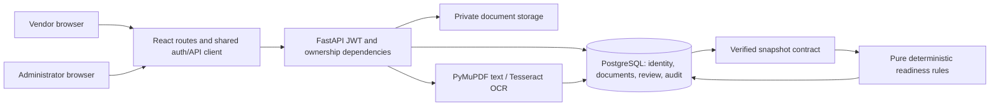

# Architecture

D1's identity/document models and D2's review models share one SQLAlchemy registry
and session dependency. Authentication loads the principal from a signed expiring
JWT and DB; no request JSON role or owner is authoritative. Native PDF processing
and OCR are untrusted extraction, never automatic verification. Review endpoints
write application state, assessment/snapshot and audit in the same transaction.

React vendor and admin routes use the same memory-only AuthProvider and shared
apiRequest. Tokens expire locally and authenticated 401 responses clear sessions.
Original evidence download requires an admin and a document in that application's
saved submission snapshot. Private files are never mounted as public static files.

Synchronous OCR work is moved off the FastAPI event loop; a failed file can be
retried by its owner. Only failed files can retry, preserving successful reviewed
fields. This is still a bounded local MVP, not a distributed processing system.
