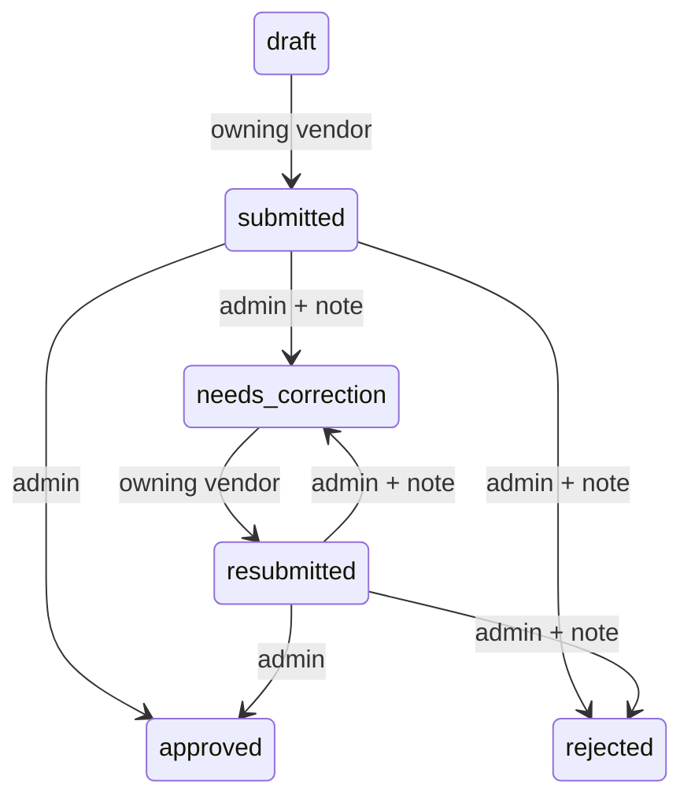

# Workflows

No other transitions are permitted. A duplicate submit in its resulting state is
idempotent and does not create another assessment/audit event. A terminal admin
decision cannot be repeated or reversed. Admin confirmation dialogs only submit
after explicit confirmation; Cancel/Escape makes no write. Backend authorization
is authoritative even if a client bypasses the UI.

Each submission/resubmission captures a new verified snapshot and versioned
assessment. Evidence survives later field edits. A correction request preserves
the reason; the vendor edits/confirms fields and resubmits for a fresh human
review. Score rules never approve or reject automatically. See REVIEW_WORKFLOW.md
for transaction/locking details and RISK_RULES.md for exact deductions.

Auth sessions stay in memory. Logout, expiry timer or authenticated 401 clears the
principal and returns the user to login. A full browser refresh requires login.
Failed extraction has a separate owner-only retry, which cannot overwrite
successfully processed or verified documents.
